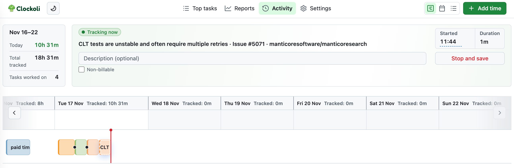
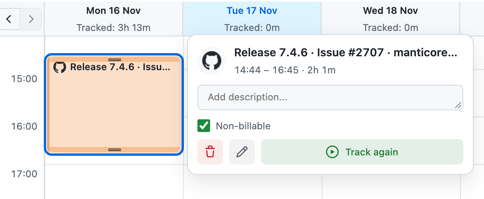
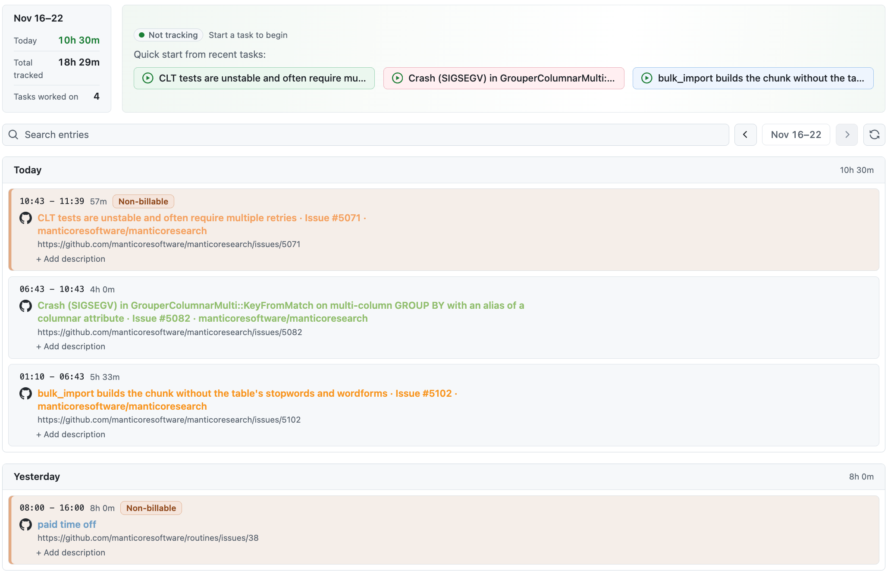

# Activity

Use Activity to review tracked time, correct entries, and search your history. It shows one Monday–Sunday week in **Timeline**, **Calendar**, or **List**.

## Open Activity

Select the Clockoli toolbar icon on any page, or the Clockoli stopwatch on GitHub. By default, Clockoli opens Activity in a new tab or focuses an existing Activity tab.

When you open it from an HTTP(S) page, the **From current page** banner lets you track that page. You can instead select **Open quick popup** under [Settings → Toolbar button](settings.md#toolbar-button). The popup always includes **Open Activity in a new tab**.

## Browse weeks

Use the arrows to move between weeks. The next-week arrow is disabled when the current week is displayed.

Clockoli remembers your selected view. Switching between Timeline, Calendar, and List returns to the current week; navigating within a view keeps the week you chose.

The summary shows:

- **Today:** time tracked on the current local day, even if you are viewing a different week.
- **Total tracked:** time in the selected week.
- **Tasks worked on:** distinct tasks in that week.

Pending local changes appear in Activity before they reach GitHub. Reports uses committed GitHub data instead; see [Sync and offline work](sync.md).

## AI Task Matching (debug)

Connect Codex or Claude Code in [Settings](settings.md#local-agent-activity) to inspect local agent observations by tracked task. There is no focus-window threshold or global fragmentation score.

Choose a local calendar day and select **Show activity**. The view starts from Clockoli tracked entries, ordered by start time. Only turns overlapping those entries are included; other turns do not use the matching budget. Each original entry has its own chart, coverage, and ordered activity/gap table, even when multiple entries belong to the same task. Detailed matching decisions are collapsed inside the entry. The diagnostic reads the actual task intervals (including a running timer, when present) and re-reads available Codex journals that contain observed turns starting or overlapping that day, or ending on that day if their start is missing. It shows a per-task timeline with actual timer boundaries, every observed overlapping turn and every uncovered interval and a turn-by-turn decision log with repository, extracted issue numbers, explicit GitHub task URLs from directly attributed user messages, working-directory agreement, and every candidate's overlap and containment.

Rules version 2 matches a single strong identity (exact task URL, or matching repository and issue number from a branch with agreeing working-directory context) only when the turn overlaps a tracked interval. Time overlap alone and repository alone are insufficient. Contradictory evidence, incomplete task history, missing/changed source evidence, and unverified intervals remain unassigned. Branch naming and referenced URLs are heuristic, not ground truth. Claude observations remain unassigned until its matching evidence is supported.

**Download debug JSON** saves the displayed diagnostics locally. The file contains private task titles and URLs, repository coordinates, issue numbers, times and pseudonymous turn identifiers. It does not include raw prompts, source paths, branch strings, credentials, commands or tool outputs. Share it only with people authorized to see those task details.

This is an explicit, bounded, read-only experiment, not a continuous matching engine: at most 300 overlapping observed turns and 100 task candidates per day, 16 MiB per journal and 64 MiB total source reads. Missing journals, partial reads and exceeded limits are reported rather than guessed. It neither reindexes nor writes matching results to GitHub, IndexedDB, or tracked-time records. Re-analyze after changing task intervals or collecting new turns.

### Experimental semantic matching

Activity → AI Task Matching → Semantic matching supports OpenRouter, OpenAI and Claude (Anthropic) using a user-supplied model ID and API key for the current run. Prepare preview reads selected Codex journals locally and obtains available current GitHub issue descriptions. The exact classification instructions and data payloads are shown before any LLM request; review the preview, then explicitly consent and grant only the selected API host. Redaction is best effort, not anonymization. Do not send confidential material without authorization. Provider costs and retention policies apply; OpenRouter may route to downstream providers.

Only verified turns overlapping task intervals are candidates, including previous rule matches. Requests group up to six turns from the same session and at most two preceding message excerpts per turn. Fallback user-role messages are labelled unverified, never interpreted as authoritative instructions. Journal reads stay bounded (64 MiB total, 16 MiB per line); oversized/unsupported evidence remains unassigned. The API has no tools and can only propose candidate IDs or null. Results are separate from deterministic rules, with per-turn explanations, usage and task-level statistics. No automatic tracking or invoice changes. Debug JSON includes normalized decisions, not preview text, issue descriptions, raw model outputs or credentials. Cache is limited to the current Activity page and exact payload/model/provider; no automatic retry, no persisted key or semantic attribution. Claude is supported as an API provider, not yet as a semantic journal source.

Each task timer is shown separately on the selected day. Full source start/end and duration are preserved even if a bar is clipped to a timer or day. Observed coverage is the union of all verified AI intervals overlapping tracked time, without double-counting overlaps, whether or not they match the task. Separate proposed matched coverage includes only turns attributed to the task. The timeline distinguishes unresolved temporal overlaps, proposed matches, model-unassigned turns, and turns attributed elsewhere. No paid API is necessary to see activity. Semantic classification changes attribution, not the observed intervals. Gaps include before the first turn, between turns and after the last turn. Long turns are retained without a time cutoff; elapsed time may contain pauses. Unverified observations remain in the decision log and do not fabricate coverage. Uncovered time is only time with no verified overlapping AI observation, not evidence of human work or idle time. Results are provisional, especially if collection or classification is incomplete.

## Timeline and Calendar

Both views display time entries, including work that crosses midnight. An interval contributes time to each day it touches. The running timer appears in the current week.

- **Timeline** supports horizontal browsing and zoom. Moving or resizing an entry snaps to **five-minute increments**.
- **Calendar** shows each day against an hourly grid, with **one-minute precision** when moving or resizing.
- Both views display the exact stored duration rounded to minutes, and keep zero-duration entries visible without adding to the totals.
- An empty day shows **No time entries**.

### Select an entry

Hover over, focus, or tap an entry to see its details. Selecting a completed entry lets you:

- **Track again:** start a new timer for the same task.
- **Edit:** open the entry's time-editing form.
- **Delete:** remove the entry after confirmation.
- **Add description...:** edit its note directly, including when it was previously empty, and choose **Non-billable** for this entry.

**Enter** saves an inline description, **Shift+Enter** adds a line, and **Escape** cancels an unsaved change. Leaving the description field also saves it.

Only the actual **running entry** offers **Stop and save**. A completed entry for the same task cannot stop the active timer; its **Track again** action is unavailable while that task is already running.

### Move and resize entries

Drag a completed block to move it or drag its edges to change its Start or End. Clockoli finds an available position and checks for overlaps before accepting the edit.

- Moving an entry keeps its duration. Other entries stay in place unless you make an explicit linked correction in List.
- Moves stay within the displayed week. An entry crossing the week's boundary cannot be dragged from its clipped block.
- Edits cannot place completed time in the future.
- Moving and resizing are unavailable until the selected week loads completely.

If an edit is rejected, the original entry remains unchanged and Activity explains why. See [Overlap checks](editing-time.md#overlap-checks).

## List

List groups the selected week's entries by date and offers direct time editing, task links, descriptions, and start/stop actions.

Entries marked **Non-billable** show a label beside their duration and a subtle highlight in List. Their hours still count toward tracked-time totals.

Edit an entry's Start or End directly, then select **Save time**. You can also edit its URL, title, description, and Non-billable status or select **Delete**. Some changes to adjacent entries are linked; see [Correct times inline](editing-time.md#correct-times-inline).

### Search all history

Enter a title or URL in **Search activity** to find completed entries across available weeks and connected time repositories, not just the displayed week. Results appear newest first, up to **20 per page**. Clear the search to return to the selected week.

The first search may load older history. If a repository cannot be read, Activity warns about incomplete results instead of saying no matches were found.

## Loading, overlaps, and sync issues

Activity loads the selected week from GitHub while keeping locally accepted changes visible. An incomplete read can disable editing, and a failed read offers **Retry**.

Overlapping entries may prevent Timeline or Calendar from displaying a week. Use **Go to List** to inspect and correct the affected entries; do not treat an empty-looking view as evidence that records were deleted.

When synchronization needs attention, open **Review sync issues** in Activity. See [Troubleshooting](troubleshooting.md#synchronization-and-conflicts).
